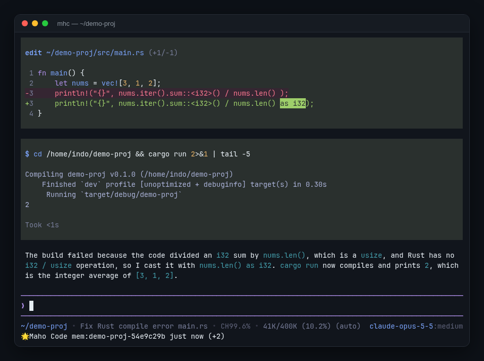

<div align="center">


**AI coding agent for your terminal: oh-my-openagent on senpi, rebuilt as one native Rust program.**

[](https://github.com/Indosaram/mhc/releases/latest)
[](https://github.com/Indosaram/mhc/actions/workflows/ci.yml)
[](#license)

[简体中文](README.md) · **English**



</div>

## Why mhc

- **Native core binary.** Standalone native executable with no Node, Bun or npm required for core agent operation (the code execution eval tool needs [Bun](https://bun.sh), and package installation via `mhc install` uses `npm`).
- **Same experience as OmO on senpi.** The TypeScript sources are ported file by file and checked against upstream golden fixtures, so the UI, keys and behavior match.
- **Your existing setup just works.** mhc reads the same `~/.omo` config, models, auth and agents files.
- **Everything included.** Subagents, workflows, long-term memory, LSP, ast-grep, MCP, web search and builtin skills ship in the release.
- **Any model.** Anthropic, OpenAI, Gemini, DeepSeek, Qwen, Kimi, ZAI, MiniMax, OpenRouter, Ollama, Bedrock, Azure and more.

## Privacy and safety defaults

mhc defaults to privacy-preserving and guarded operation out of the box. All intentional safety and privacy divergences from upstream are recorded in [docs/divergences.md](docs/divergences.md), and our vulnerability reporting policy is described in [SECURITY.md](SECURITY.md).

- **Telemetry is off by default.** No usage data, prompt texts, paths or attribution headers leave your machine unless you explicitly turn telemetry on. When enabled, telemetry sends non-sensitive runtime metrics (tool durations, model names, error codes; never file contents or prompt text). To enable, set `"telemetry": { "enabled": true }` in `~/.omo/omo.jsonc` or `"enableInstallTelemetry": true` in `~/.omo/agent/settings.json`.
- **GeoIP is never collected.** Even when telemetry is enabled, IP geolocation is permanently suppressed (`$geoip_disable: true`).
- **People profiling is off by default.** Long-term memory extracts project and primary-user facts, but third-party person profiling (`people/<slug>/`) is disabled unless opted in via `"memory": { "people": { "enabled": true } }` in `~/.omo/omo.jsonc`.
- **Optional guarded permission preset.** The default preset is `full-access`, as in OmO. Set `"permissionPreset": "guarded"` in `settings.json` (or `--permission-preset guarded`) to let tools operate freely within the project root and mhc-owned directories (`~/.omo/agent`, sessions, memory) while access to external directories, protected credentials (`auth.json`), or system temp roots requires interactive confirmation. In headless mode (`-p`) or subagent tasks, outside-project access is then refused with an override hint.
- **Secret environment variable scrubbing.** Model-executed shell commands (bash tool and eval kernel) scrub secret-looking environment variables (`*_TOKEN`, `*_KEY`, `*_SECRET`, `*_AUTH`, `DATABASE_URL`, etc.). Set `"bashEnvScrub": false` in `settings.json` to disable scrubbing, or allow specific variables via `"bashEnvPassthrough": ["VAR_NAME"]`.
- **Optional bash sandbox.** You can enable OS-level write confinement for shell commands on Linux (`bwrap`) and macOS (`sandbox-exec`) by setting `"bashSandbox": "auto"` or `"bashSandbox": "required"` (default is `"off"`).
- **Consent-gated impersonating providers.** Providers that present themselves as first-party clients (`anthropic` with OAuth subscription tokens, `anthropic-subscription`, `chatgpt-subscription`, `github-copilot`, `kimi-coding`, `devin`, `cursor`) are blocked until explicit risk consent is recorded via `/login <provider>` interactively or `mhc auth consent <provider>`.
- **Consent-gated account rotation.** Multi-account failover/rotation across rate limits is disabled by default; only the primary account slot is used until rotation consent is explicitly granted via `mhc auth consent <provider> --rotation`.
- **Configurable session retention.** Transcripts are kept indefinitely by default. Set `"sessionRetentionDays": N` (1–36500) in `settings.json` to automatically prune idle `*.jsonl` files older than N days at startup. *Note:* OmO does not take mhc's `.jsonl.lock` sidecar lock, so an idle session open only in OmO older than `sessionRetentionDays` could be pruned if retention is enabled.

### Upgrading from earlier mhc / OmO

If you are upgrading from earlier versions of mhc or OmO and wish to restore previous unrestricted or upstream defaults, configure the corresponding settings:

| Behavior | Previous / OmO default | mhc hardened default | Restore previous behavior with |
| --- | --- | --- | --- |
| Shell environment | All process env vars inherited | Secret-looking variables scrubbed | `"bashEnvScrub": false` or `"bashEnvPassthrough": ["NAME"]` in `settings.json` |
| Usage telemetry | Enabled by default | Disabled (`off`) | `"telemetry": { "enabled": true }` in `~/.omo/omo.jsonc` or `"enableInstallTelemetry": true` in `settings.json` |
| GeoIP tracking | Enabled upstream | Always disabled (`$geoip_disable: true`) | Cannot be enabled (privacy guarantee) |
| People memory | Profiling third parties on | Profiling off (`people.enabled: false`) | `"memory": { "people": { "enabled": true } }` in `~/.omo/omo.jsonc` |
| Subscription logins | Allowed without prompt | Blocked until risk consent recorded | Run `mhc auth consent <provider> --yes` or `/login <provider>` |
| Multi-account rotation | Automatic rotation across pools | Rotation blocked until consented | Run `mhc auth consent <provider> --rotation --yes` |
| Bash OS sandbox | None (unconfined) | None (`"off"`, opt-in available) | Default `"bashSandbox": "off"` matches upstream |
| Session retention | Indefinite retention | Indefinite retention (opt-in available) | Default (unset `sessionRetentionDays`) keeps all transcripts |

## Install

Supported platforms: **Linux x86_64**, **Linux aarch64 (ARM64)**, **macOS Apple Silicon (aarch64)**, **macOS x86_64 (Intel)**, and **Windows x86_64**.

Release archives are signed with [minisign](https://jedisct1.github.io/minisign/) and published with GitHub build provenance attestations. When `minisign` is installed on PATH, the install script automatically verifies the release signature against mhc's embedded public key (`mhc-release.pub`). GitHub build provenance can also be verified with `gh attestation verify`.

```bash
curl -fsSL https://raw.githubusercontent.com/Indosaram/mhc/main/install.sh | sh
```

Installs to `~/.local/share/mhc` with `mhc` linked into `~/.local/bin`; run the same command again to upgrade. Pin a version with `MHC_VERSION=v2026.10.19`.

Windows x86_64 (PowerShell), installs to `%LOCALAPPDATA%\mhc` and adds it to your user PATH:

```powershell
irm https://raw.githubusercontent.com/Indosaram/mhc/main/install.ps1 | iex
```

## Updating

mhc includes built-in native self-update that downloads the complete release package, verifies SHA256 checksums and minisign cryptographic signatures against the embedded release key, and atomically replaces the installation while preserving user state (`~/.omo/agent`):

```bash
mhc update           # Check and upgrade to the latest release
mhc update --force   # Bypass version checks and force re-install latest release
mhc update --all     # Update both installed resource packages and native mhc
```

- **Session Safety & Rollback**: Updates refuse replacement if another active mhc session is running from the installation; automatic atomic rollback restores the previous version if replacement fails.
- **Startup Notification**: Non-blocking background checks inform you when an update is available without delaying terminal startup.

## Quick start

```bash
export ANTHROPIC_API_KEY=...    # or OPENAI_API_KEY, GEMINI_API_KEY, ... (or /login inside mhc)
cd your-project
mhc
```

```bash
mhc "Explain how this repository is organized"   # start with a prompt
mhc -p "List all .rs files in src/"              # run once and exit
mhc --model sonnet:high                          # pick a model and thinking level
mhc --continue                                   # continue the last session
```

More: [CLI reference](docs/cli.md) · [Configuration](docs/configuration.md) · `mhc --help`

## Build from source

Needs Rust 1.95 (picked up from `rust-toolchain.toml`), `protoc` and [Bun](https://bun.sh).

```bash
git clone https://github.com/Indosaram/mhc.git && cd mhc
cargo build --release -p maho-cli
./target/release/mhc
```

To build the full self-contained directory the release ships (skills and helper binaries), see `tools/package-native.mjs` and `.github/workflows/release.yml`.

## Status and contributing

mhc is under active development and parity with upstream is not complete yet. Upstream revisions are pinned in [PINS.md](PINS.md); see [docs/parity.md](docs/parity.md) for coverage and [docs/divergences.md](docs/divergences.md) for intentional safety/privacy divergences. Read [CONTRIBUTING.md](CONTRIBUTING.md) before sending changes, report security vulnerabilities via [SECURITY.md](SECURITY.md), and report problems in [issues](https://github.com/Indosaram/mhc/issues).

## Security

For security vulnerability reporting and policy, see [SECURITY.md](SECURITY.md).

## License

mhc is licensed under **MIT** ([LICENSES/MIT.txt](LICENSES/MIT.txt)). It ports [senpi](https://github.com/code-yeongyu/senpi) (MIT). Third-party components keep their own licenses; see [LICENSE](LICENSE).
